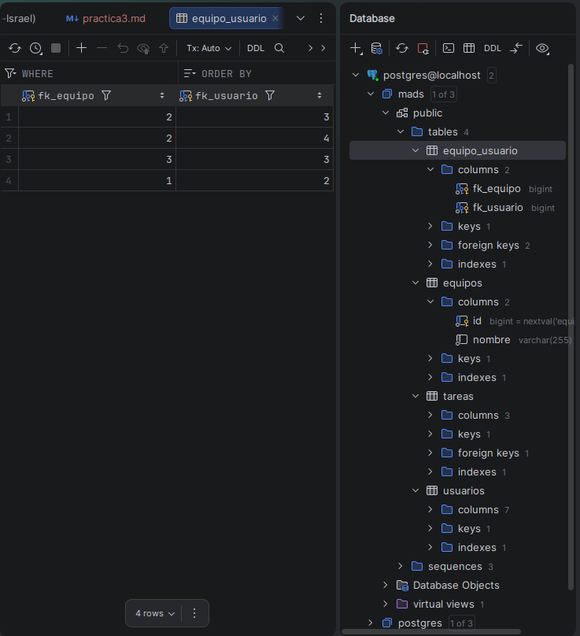

# Documentación Práctica 3

## 1. Introducción

Esta práctica amplía la aplicación ToDoList con la gestión de equipos. Se han
implementado las historias de usuario 009 y 010: cualquier usuario autenticado
puede crear equipos y unirse o salir de ellos, mientras que el administrador
puede cambiar el nombre de un equipo y eliminarlo. Se mantiene la arquitectura
por capas del proyecto: modelo, repositorio, servicio, controlador, DTO y
plantillas Thymeleaf.

## 2. Base de datos PostgreSQL

La aplicación utiliza PostgreSQL con el perfil `postgres`, con la base de datos
`mads`. Las tablas principales son `usuarios`, `equipos`, `tareas` y la tabla
intermedia `equipo_usuario`, que representa la relación muchos-a-muchos entre
usuarios y equipos. Cada fila de `equipo_usuario` contiene las claves
`fk_equipo` y `fk_usuario`.



## 3. Endpoints implementados

Todas las rutas están en `EquipoController` y exigen un usuario autenticado;
las de gestión exigen además rol de administrador.

- `GET /equipos`: obtiene los equipos ordenados por nombre con
  `findAllOrdenadoPorNombre()` y los equipos del usuario con
  `equiposUsuario()`. Renderiza `listaEquipos.html` y muestra, por cada equipo,
  si el usuario pertenece a él.
- `GET /equipos/{id}`: recupera el equipo y sus miembros mediante
  `recuperarEquipo()` y `usuariosEquipo()`. Renderiza
  `descripcionEquipo.html`.
- `GET /equipos/nueva` y `POST /equipos/nueva`: muestran el formulario y crean
  el equipo con `crearEquipo()`. Si el nombre está vacío o ya existe, el
  servicio lanza `EquipoServiceException` y se vuelve al formulario con el
  error.
- `POST /equipos/{id}/unirse` y `POST /equipos/{id}/salir`: añaden o eliminan
  al usuario logueado con `añadirUsuarioAEquipo()` y
  `eliminarUsuarioDeEquipo()`. Redirigen al listado con un mensaje flash.
- `GET /equipos/{id}/editar` y `POST /equipos/{id}/editar`: solo para el
  administrador. Muestran `formEditarEquipo.html` y renombran con
  `renombrarEquipo()`.
- `DELETE /equipos/{id}`: solo para el administrador. Elimina el equipo con
  `eliminarEquipo()` y responde con `@ResponseBody`.

## 4. Clases y métodos

La entidad `Equipo` contiene `id`, `nombre` y la colección `usuarios`, anotada
con `@ManyToMany` y `@JoinTable` sobre `equipo_usuario`. Se añadió
`setNombre()` para permitir el renombrado. `Usuario` mantiene el lado inverso
con `@ManyToMany(mappedBy = "usuarios")`.

`EquipoData` es el DTO que transporta `id` y `nombre` entre capas.
`EquipoRepository` sigue siendo un `CrudRepository`; no se han añadido métodos
nuevos, sino que las comprobaciones usan `findAll()`.

`EquipoService` concentra la lógica:
- `crearEquipo()` y `renombrarEquipo()` validan nombre vacío y duplicado.
- `añadirUsuarioAEquipo()` y `eliminarUsuarioDeEquipo()` actualizan ambos
  lados de la relación y lanzan excepción si el usuario ya pertenece o no
  pertenece al equipo.
- `eliminarEquipo()` recorre los usuarios para quitar el equipo de su
  colección, limpia la del equipo y lo borra.

## 5. Plantillas Thymeleaf

- `listaEquipos.html`: listado con enlaces al detalle, botones “Unirme” o
  “Salir del equipo”, botón “Nuevo equipo” y mensajes flash. La columna
  “Gestión” solo aparece si `usuarioLogueado.administrador` es verdadero, con
  “Cambiar nombre” y “Eliminar”. El borrado pide confirmación con `confirm()`
  y envía un `DELETE` con `fetch`.
- `descripcionEquipo.html`: datos del equipo, tabla de miembros y botón para
  unirse o salir.
- `formNuevoEquipo.html` y `formEditarEquipo.html`: formularios con
  validación HTML y zona de error.
- `fragments.html`: se añadió la opción “Equipos” al menú.

## 6. Tests

En `EquipoServiceTest` se comprueban la creación, el listado ordenado, la
relación usuario-equipo, la unión y salida, el renombrado y la eliminación,
incluyendo errores por nombres duplicados o equipos inexistentes.

En `EquipoWebTest` se usa `MockMvc`, `@SpringBootTest`, `@Sql("/clean-db.sql")`
y un `@MockBean` de `ManagerUserSession` para simular el usuario logueado. Se
verifican el listado, el detalle, la creación, unirse, salir, el formulario de
edición, el renombrado, el duplicado, la eliminación y los **403** para
usuarios no administradores. Para probar ambos roles se registra un usuario
con `administrador = true` o `false`.

## 7. Fragmentos de código destacados

La comprobación de duplicados al renombrar excluye el propio equipo y normaliza
el nombre:

```java
boolean existe = equipoRepository.findAll().stream().anyMatch(e -> !e.getId().equals(id)&& e.getNombre().equalsIgnoreCase(nombre));
//Al eliminar un equipo se actualizan los dos lados de la relación antes del borrado, evitando referencias inconsistentes:
for (Usuario usuario : new HashSet<>(equipo.getUsuarios())) {
    usuario.getEquipos().remove(equipo);
}
equipo.getUsuarios().clear();
equipoRepository.delete(equipo);
```

La autorización se centraliza en comprobarAdministrador(), que lanza un 403 si el usuario no tiene el rol. Así la seguridad no depende de ocultar botones en la vista. Además, el patrón Post/Redirect/Get con  RedirectAttributes evita reenviar formularios al refrescar.